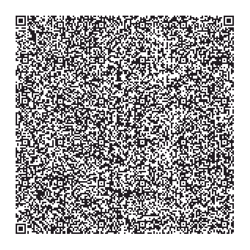
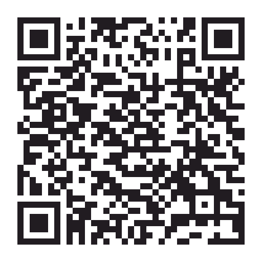
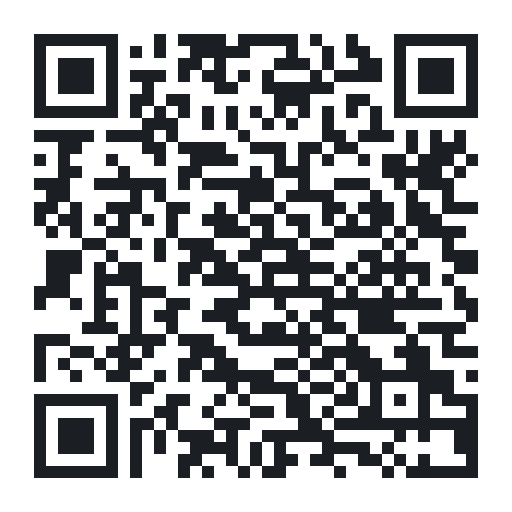

# Archived Manuals and API References

Documentation for earlier OpenGarage firmware versions. Versions 1.2.5 and 1.2.4 have online documentation; older documents are PDFs.

| Firmware | User Manual | API Reference |
|:---------|:------------|:--------------|
| 1.2.5 | [User Manual](1.2.5/manual.md) | [API Reference](1.2.5/api.md) |
| 1.2.4 | [User Manual](1.2.4/manual.md) | [API Reference](1.2.4/api.md) |
| 1.2.3 | [Manual (PDF)](assets/pdfs/OGManual1.2.3.pdf) | [API (PDF)](assets/pdfs/OGAPI1.2.3.pdf) |
| 1.2.0 | [Manual (PDF)](assets/pdfs/OGManual1.2.0.pdf) | [API (PDF)](assets/pdfs/OGAPI1.2.0.pdf) |
| 1.1.2 | [Manual (PDF)](assets/pdfs/OGManual1.1.2.pdf) | [API (PDF)](assets/pdfs/OGAPI1.1.2.pdf) |
| 1.1.0 | [Manual (PDF)](assets/pdfs/OGManual1.1.0.pdf) | [API (PDF)](assets/pdfs/OGAPI1.1.0.pdf) |
| 1.0.9 | — | [API (PDF)](assets/pdfs/OGAPI1.0.9.pdf) |
| 1.0.7 | [Manual (PDF)](assets/pdfs/OGManual1.0.7.pdf) | [API (PDF)](assets/pdfs/OGAPI1.0.7.pdf) |
| 1.0.6 | — | [API (PDF)](assets/pdfs/OGAPI1.0.6.pdf) |
| 1.0.5 | — | [API (PDF)](assets/pdfs/OGAPI1.0.5.pdf) |
| 1.0.4 | — | [API (PDF)](assets/pdfs/OGAPI1.0.4.pdf) |

---

### Blynk Legacy App

!!! warning "Archived — Blynk is no longer supported"
    These instructions are retained for historical reference because older manuals link here. They are no longer supported setup instructions. Blynk support was removed from firmware 1.2.6, and the OpenThings Blynk server will be retired soon; use [OpenThings Cloud (OTC)](guides/remote-access-otc.md) for remote access instead. The legacy instructions do not apply to the new Blynk IoT app.

The Blynk **legacy app** is discontinued and no longer available in the official app stores. The former setup procedure is preserved below:

* Archived reference: [Blynk (Legacy) App Support Article](https://openthings.freshdesk.com/a/solutions/articles/5000872170).

* Launch the app, sign in with your account credentials, tap the **QR code** icon, and scan the appropriate QR code below. This creates a project in the app, and the Blynk token will be emailed to you (you can copy the token manually from the Project Settings in the app).

##### **v1.3**
* Requires firmware `1.2.4`–`1.2.5`
* Door status LED uses distinct colors for each state
* Added light and lock toggles
{: .center_wider}

|Virtual pin |Used for|
|:--------  -|:------------|
|`V0`| Door status (binary) |
|`V1`| Trigger door action |
|`V2`| Door status (complete: including stopped, opening, closing) |
|`V3`| Distance value |
|`V4`| Car status |
|`V6`| Temperature (if temperature sensor is enabled) |
|`V7`| Humidity (if humidity sensor is enabled) |
|`V8`| Toggle light |
|`V9`| Toggle remote lock |

##### **v1.2**
* Requires firmware `1.1.2`–`1.2.5`
* Added temperature and humidity history (if the sensors are enabled)
{: .center}

##### **v1.1**
* Requires firmware `1.0.9`–`1.2.5`
* Added Car Status LED
{: .center}

##### **v1.0**
* The original version
{: .center}
---
