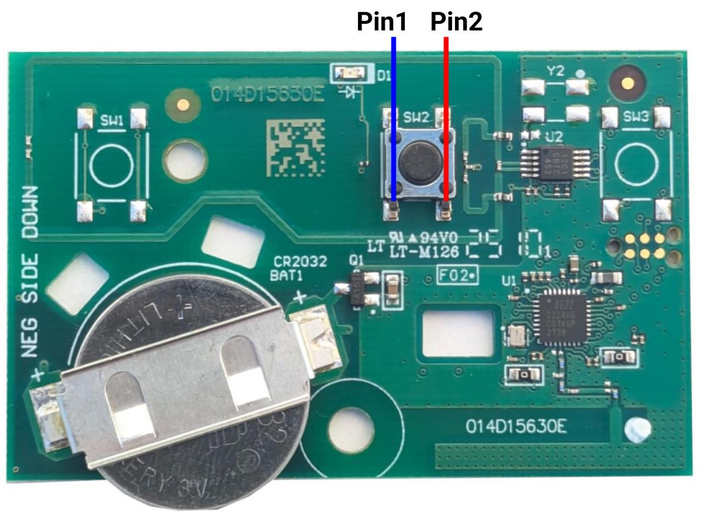
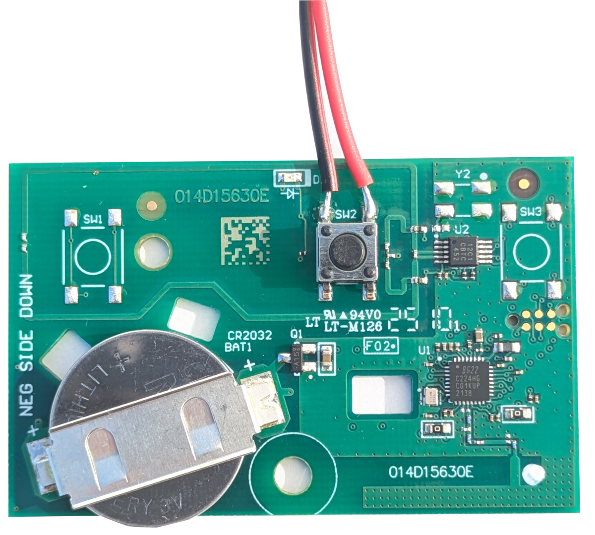
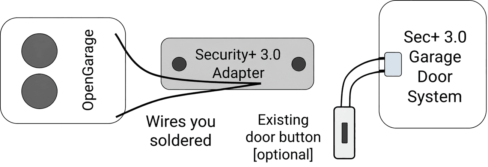

# DIY Security+ 3.0 Adapter

OpenGarage v2.3+ supports **Security+ 2.0 and 1.0 natively**. However, Security+ 3.0 garage door openers, identified by a **white Learn button**, are not natively supported. To use OpenGarage with a Security+ 3.0 opener, you need a spare compatible remote—a “sacrifice remote”—as an adapter between OpenGarage and the opener.

Here is how it works: OpenGarage's built-in output can simulate a button press on the remote, which subsequently sends the Security+ 3.0 command wirelessly to the opener. This guide explains how to make that adapter yourself by **soldering** two wires onto the remote's button contacts. For background, see [Security+ 3.0: How to Use It with OpenGarage](https://opensprinkler.com/security-3-0-how-to-use-it-with-opengarage/).

## Step 1: Prepare a Sacrifice Remote

Prepare a spare Security+ 3.0 remote, such as the [LiftMaster L991S](https://www.liftmaster.com/liftmaster-1-button-remote/p/L991S) or [Chamberlain CH361](https://www.chamberlain.com/1-button-remote/p/CH361). Pair it with your opener according to its instructions and confirm that the button you intend to modify operates the door successfully.

## Step 2: Identify the Button Contacts

Open the remote's enclosure, take out the circuit board, and locate the button you want to solder wires onto. A typical button has four contact pins but only two are unique: the pair of pins on the same line are internally connected therefore are the same pin, as shown below.

{ .img-border .img-center .guide-screenshot width="600" }

## Step 3: Polarity and Soldering

Use a multimeter to measure the **DC voltage** on the two button pins. Swap the probes if necessary until the meter reads a **positive voltage**, at which point the pin under the **red** probe is **positive**, and that under the **black** probe is **negative**.

Next, solder a **red** wire to the **positive** pin and a **black or blue** wire to the **negative** pin. The picture below shows an example. The specific polarity depends on your multimeter findings.

{ .img-border .img-center .guide-screenshot width="600" }

## Step 4: Reassemble the Remote

Put the circuit board back into its enclosure. Cut a notch in the enclosure as necessary to allow the soldered wires to pass through.

## Step 5: Connect and Configure OpenGarage

Connect the two soldered wires to OpenGarage according to its hardware version:

* **v2.3+:** Polarity matters. Connect the **positive (red)** wire to **Red/Ctrl** terminal on OpenGarage, and the **negative** wire to **White/GND** terminal. Set **Security+ Version** to **None**.
* **v2.2 and earlier:** There is no polarity, so the two wires can connect either way. There is also no Security+ Version setting to select.

{ .img-border .img-center .guide-screenshot width="650" }

**<u>NOTE</u>:** The adapter provides door-button control only; it does not return opener status. OpenGarage can use its ultrasonic distance sensor to monitor door position. Opener light and remote lock control through Security+ 3.0 are not available with this setup.
