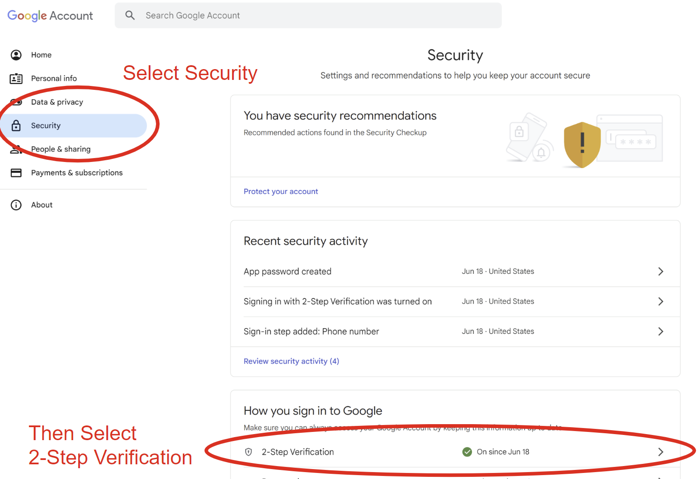
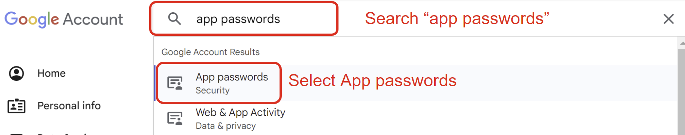
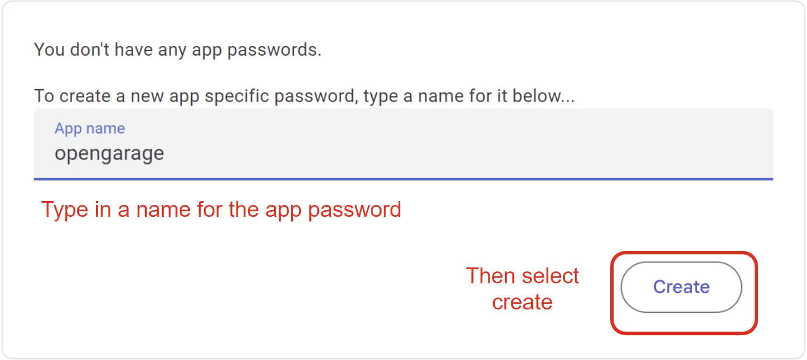
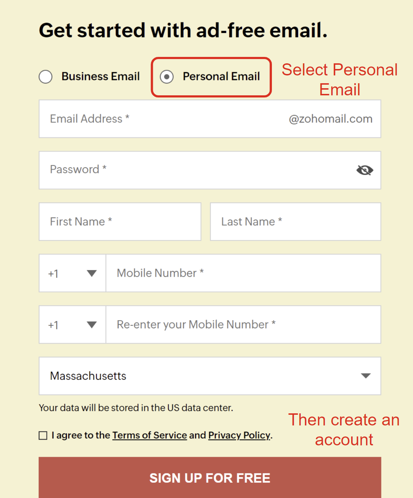
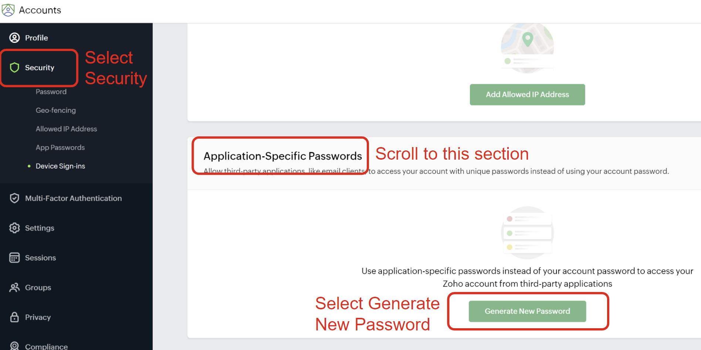
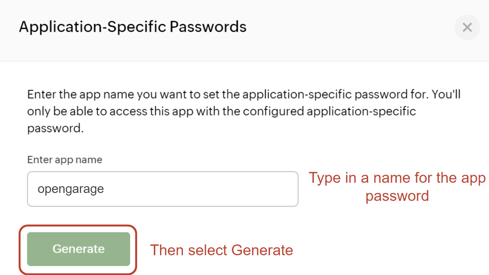
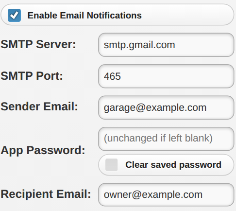

# Setting Up Email Notifications

OpenGarage **stock firmware 1.2.3 and later** supports email notifications through an SMTP server. Email does not require an OTC token.

## How Email Notifications Work and Best Practices

OpenGarage sends email notifications using a user-selected **SMTP** (Simple Mail Transfer Protocol) server, such as [Gmail](https://www.gmail.com) or [Zoho Mail](https://www.zoho.com/mail).

* When a notification event occurs, the firmware connects to the configured SMTP server and sends the message.
* OpenGarage uses implicit TLS, normally on port **465**. Providers that require STARTTLS on port 587 are not supported.
* Gmail and Zoho Mail have been used successfully with OpenGarage. Other providers must support compatible SMTP authentication and implicit TLS.

The **Sender Email + App Password** act as login credentials for the SMTP server. The **Recipient Email** can be any email address and does not have to use the same provider as the sender.

Note that Email providers limit sending rates. See the current [Gmail sending limits](https://support.google.com/mail/answer/22839) or [Zoho Mail rates and limits](https://www.zoho.com/mail/help/adminconsole/rates-and-limits.html). We recommend a dedicated sender account for notifications, with your usual email address as the recipient.

---

## Step 1: Create a Sender Email Account and App Password

### Option 1: Gmail SMTP

* Navigate to [this page](https://www.google.com/intl/en-US/gmail/about/) to create a new personal Gmail account. Even if you already have a Gmail account, consider creating a separate one dedicated to notifications.
* After creating this account, navigate to [myaccount.google.com](https://myaccount.google.com). Once there, select the **Security** tab and scroll down to **2-Step Verification**. Google will not let you create an app password without this enabled. See the screenshot below.

{ .img-border .img-center .guide-screenshot }

* Follow the steps to activate 2-Step verification, then go back to [myaccount.google.com](https://myaccount.google.com) and enter **app passwords** into the search bar at the top. Select **App Passwords** in the search results.

{ .img-border .img-center .guide-screenshot }

* On the app passwords screen, enter an App name (e.g. **opengarage**) and press **Create**.

{ .img-border .img-center .guide-screenshot width="450" }

* A popup window will show a 16-character password in the format `"xxxx xxxx xxxx xxxx"`. Save it securely because this is the **only time it is shown**. When entering it in OpenGarage, omit the spaces. If you lose it, create a new app password.

!!! note
    Google App Passwords require 2-Step Verification and may not be available for some managed, security-key-only, or Advanced Protection accounts. See [Google's App Password documentation](https://support.google.com/accounts/answer/185833) for current requirements.

---

### Option 2: Zoho SMTP

If you prefer an alternative to Gmail, Zoho Mail is a recommended option that has been tested.

* Navigate to the [Zoho Mail website](https://www.zoho.com/mail/) to create a **personal account**. Make sure to select **Personal Email**, not the default **Business Email**.

{ .img-border .img-center .guide-screenshot width="300" }

* Once you have created your account and logged in, navigate to [accounts.zoho.com](https://accounts.zoho.com). Select the **Security** tab, find **Application-Specific Passwords**, and click **Generate New Password**.

{ .img-border .img-center .guide-screenshot }

* A window will open to create a new app password. Enter an **app name** (for example, **OpenGarage**) and click **Generate**. Save the password securely because this is the **only time it is shown**. If you lose it, create a new app password.

!!! note
    In some cases, Zoho may ask you to verify your account password. Complete the prompt, return to the app-password page, and click **Generate** again.

{ .img-border .img-center .guide-screenshot width="450" }

---

## Step 2: Configure Email Settings

Open your OpenGarage's local homepage, go to **Options** → **Integration**, and check **Enable Email Notifications**. Enter:

| **Parameter** | **Value** |
| ------------- | --------- |
| **SMTP Server** | `smtp.gmail.com` (Gmail) or `smtp.zoho.com` (Zoho Mail) |
| **SMTP Port** | `465` |
| **Sender Email** | The account used to create the app password in Step 1 |
| **App Password** | The application-specific password from Step 1; omit spaces from a Gmail app password |
| **Recipient Email** | The address where you want to receive notifications |

{ .img-border .img-center .guide-screenshot width="300" }

The screenshot shows firmware 1.2.6; labels may differ on older versions.

On firmware 1.2.6 and later, the saved app password is not displayed. Leave the field blank to keep it, enter a new value to replace it, or use **Clear saved password** to remove it. Do not enter a replacement and select Clear together.

---

## Step 3: Choose Events and Save

In **Options** → **Integration**, use **Choose Notification Events** to select **Door Opened**, **Door Closed**, and, on firmware supporting it, **Door Stopped**.

You can also enable **Notify me** under **Automation** to receive a notification if the door is left open beyond the configured duration or UTC hour. Auto-close is a separate option; enabling notifications does not require enabling auto-close.

Set a recognizable **Device Name** in **Options** → **Basic**. This name appears in notification messages and helps identify the sender when you have multiple OpenGarage devices.

Enter your **Device Key** and submit the changes. To test, observe a normal door opening or closing and check the recipient's inbox and spam folder.

**<u>Notes</u>.** The notification-event and Device Name settings also apply to MQTT and IFTTT notifications when those services are enabled. Multiple OpenGarage devices can share the same email settings as long as their combined sending rate stays within the provider's limits. You can also use a separate sender account for each device while keeping the same recipient address.
