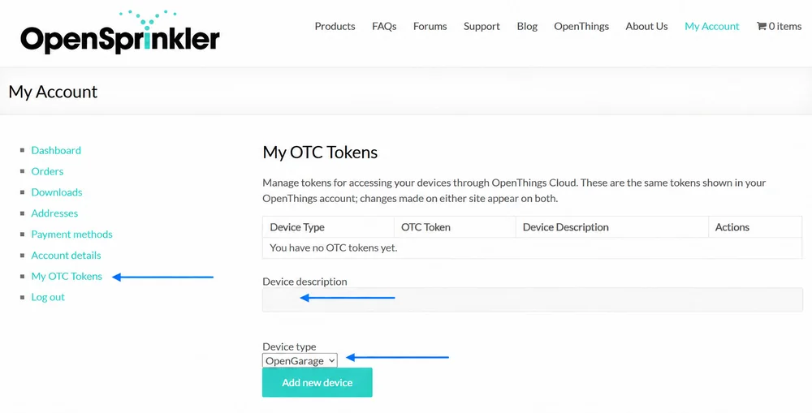
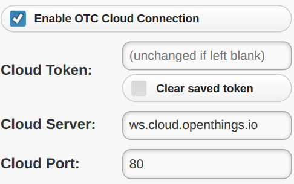

# Remote Access with OpenThings Cloud (OTC)

OpenThings Cloud (OTC) lets you access OpenGarage remotely without router port forwarding. It provides access to the built-in web interface, including door controls, settings and logs, and works with the OpenGarage Web app.

OTC is available in **stock firmware 1.2.0 and later**. You do not need it for local access or the Home Assistant integration. The alternative ESPHome firmware uses Home Assistant for remote access and does not use OTC.

!!! note
    Blynk is no longer supported starting with **firmware 1.2.6**. Use an OTC token for cloud access; a Blynk token cannot be used as an OTC token.

!!! warning
    Treat your OTC token as a password. It grants remote access to the controller, including most settings and controls. Keep it private.

## Step 1: Create an OTC Token

1. Sign in at [opensprinkler.com → My Account](https://opensprinkler.com/my-account/). If you do not yet have an account, register there.
2. Select **My OTC Tokens** in the menu on the left.
3. Enter a **Device description**, select **OpenGarage** as the **Device type**, and click **Add new device**.
4. Click **Copy** beside the generated 32-character OTC token.

{ .img-border .img-center .guide-screenshot }

---

## Step 2: Configure OpenGarage

1. Open your OpenGarage's local IP address in a browser.
2. Go to **Options** → **Integration** and check **Enable OTC Cloud Connection**.
    * *On older firmware, enable cloud connection and select **OTC**.*
3. Paste the token into **Cloud Token**. Leave the default **Cloud Server** as `ws.cloud.openthings.io` and **Cloud Port** as `80`, unless you use your own OTC server.
4. Enter your **Device Key**, submit the changes, and reboot OpenGarage.

{ .img-border .img-center .guide-screenshot width="350" }

After rebooting, check **Cloud** on the homepage:

* **OTC (connected)**: Ready for remote access.
* **OTC (connecting...)**: Wait and check again.
* **OTC (disconnected)**: Check the Internet connection, token, server and port. After an extended outage, reconnection can take several minutes.
* **None**: Cloud access is disabled.

On firmware 1.2.6 and later, the token field is blank when you reopen Options. Leave it blank to keep the saved token.

---

## Step 3: Access OpenGarage Remotely

**<u>OpenGarage Web App</u>.** Open the [OpenGarage Web app](https://raysfiles.com/og/og_devices.html), click **Add**, and add a device using its OTC token. You can manage multiple devices and open the selected device's built-in homepage for settings and logs.

The app remembers your devices in the browser's local storage. Bookmark it or use **Add to Home Screen** on your phone. The native **OpenGarage Web** app is also available in the [iOS App Store](https://apps.apple.com/us/app/opengarage-web/id6758858574) and [Google Play Store](https://play.google.com/store/apps/details?id=io.opengarage.app).

**<u>Direct Browser Access</u>.** You can access the controller directly in a web browser using:

```text
https://cloud.openthings.io/forward/v1/YOUR_OTC_TOKEN/
```

Replace `YOUR_OTC_TOKEN` with your 32-character token. This URL contains your credential, so avoid sharing it or including it in screenshots.

**<u>Limitations</u>.** Firmware updates require a direct local connection and are not available through OTC. Keep the controller's local IP address or hostname for firmware updates and local access.
