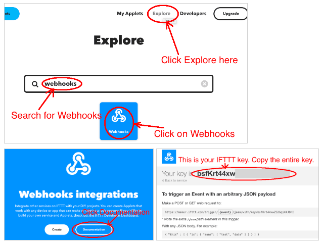
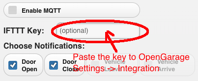
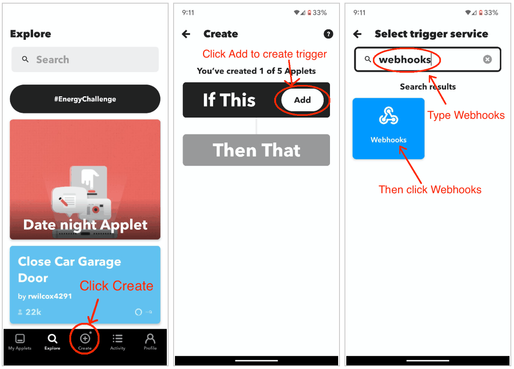
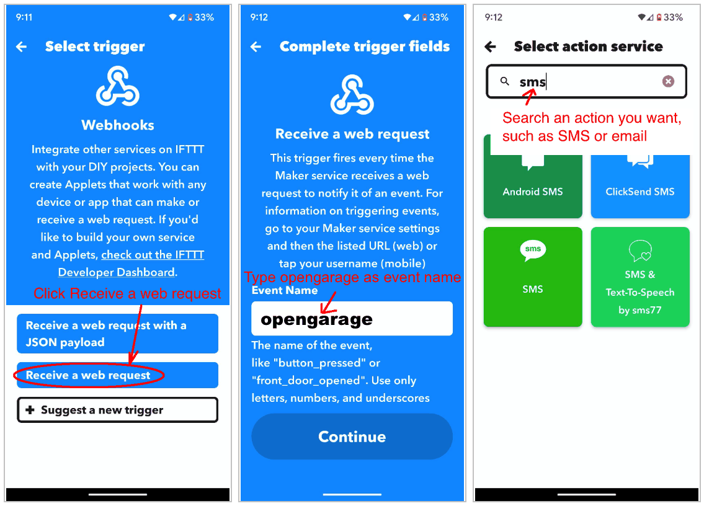
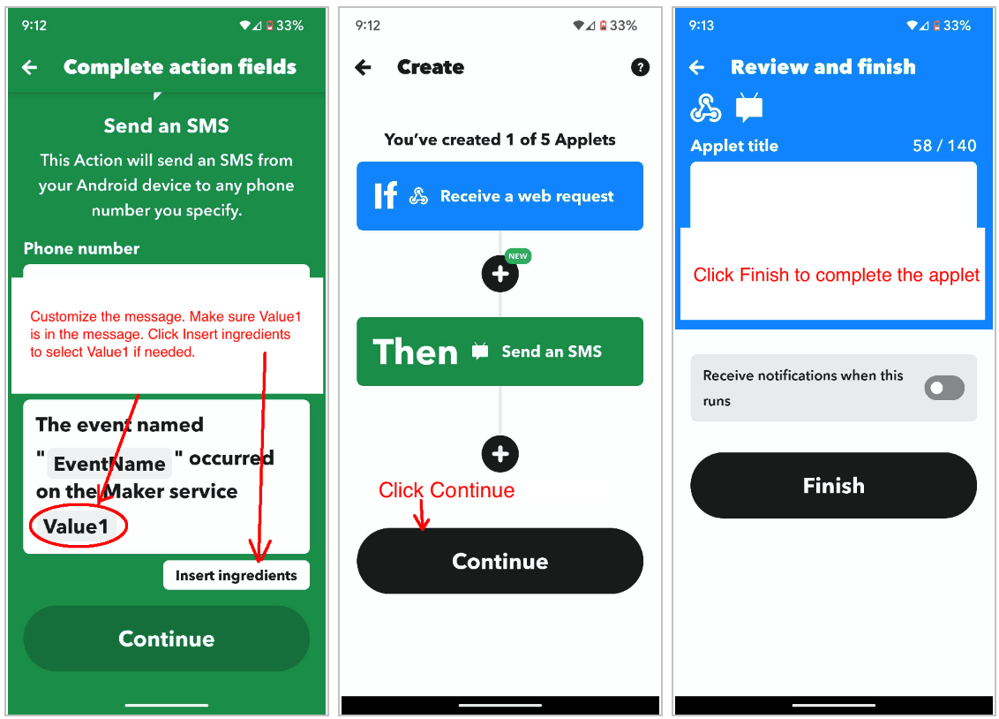

# Using OpenGarage with IFTTT

OpenGarage has built-in support for email notifications and MQTT, and these are the recommended ways to receive notifications for most users. See [Setting Up Email Notifications](email-notifications.md), and the [MQTT section](../api/index.html#9-mqtt) of the API reference for use with home automation systems. If you prefer IFTTT, OpenGarage can also send notifications through it.

An IFTTT applet connects a trigger (the “if this” part) to an action (the “then that” part). Here, an OpenGarage notification triggers a Webhooks event, and the action delivers a text, email, or push notification.

## Step 1: Get Your IFTTT Key

1. Open the IFTTT mobile app or visit [ifttt.com](https://ifttt.com/), then sign in or create an account.
2. Select **Explore**, search for **Webhooks**, and open that service.
3. Select **Documentation** to find your Webhooks key. Copy the entire key.

    { .img-border .img-center .guide-screenshot width="650" }

4. Open your OpenGarage settings, go to **Integration**, and paste the key into **IFTTT Key**. Choose the notification events you want, then enter your Device Key and save.

    { .img-border .img-center .guide-screenshot width="450" }

The screenshots show the original IFTTT and OpenGarage interfaces; their appearance may differ from current versions. On firmware 1.2.6 and later, a saved IFTTT key is not displayed. Leave the field blank to keep it, or enter a new key to replace it.

## Step 2: Create an Applet

You can create the applet in a browser or in the IFTTT mobile app. The screenshots below use the app.

1. Select **Create**, then add a trigger under **If This**.
2. Search for and select **Webhooks**.

    { .img-border .img-center .guide-screenshot }

3. Select **Receive a web request**.
4. Enter **`opengarage`** as the event name, exactly as shown. This is the event name used by the firmware. Continue to create the trigger.
5. Under **Then That**, choose the notification service you want, such as SMS, email, or push notifications.

    { .img-border .img-center .guide-screenshot }

6. Configure the action. Keep **`Value1`** in the message: OpenGarage sends its notification text in this parameter. If it is missing, use **Insert ingredients** to add it.
7. Continue, review the applet, and select **Finish**. You can edit the action or message later.

    { .img-border .img-center .guide-screenshot }
